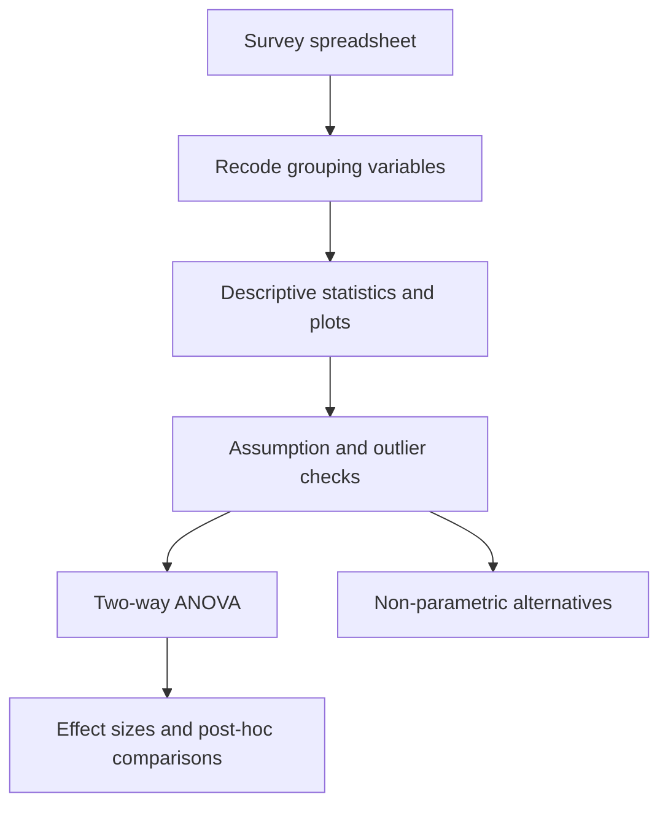

# Factorial Analysis of Living Conditions and PHQ-9 Scores

An R analysis examining how living conditions and area of residence relate to PHQ-9 depression scores, including a two-factor interaction and follow-up analyses.

## Research question

How do living conditions and residential area relate to PHQ-9 scores, and is there evidence that the association with one factor depends on the other?

## Analysis workflow



## Methods

1. Import the source spreadsheet and recode living conditions and residential area as categorical factors.
2. Inspect group sizes, means, standard deviations, skewness, and kurtosis.
3. Visualise PHQ-9 scores across groups.
4. Examine distributional assumptions, variance homogeneity, and potential outliers.
5. Fit a two-way ANOVA with both main effects and their interaction.
6. Estimate effect sizes and conduct Tukey post-hoc comparisons.
7. Run a one-way follow-up analysis and non-parametric alternatives (Kruskal–Wallis and Dunn tests).

## Implementation

- **Language:** R
- **Main script:** `factorial_anova_phq9.R`

```r
install.packages(c(
  "tidyverse", "readxl", "rstatix", "ggpubr", "car",
  "purrr", "MASS", "multcomp", "outliers", "lsr",
  "moments", "officer"
))
```

## Input data

The script opens a file-selection dialog and expects an Excel workbook containing at least these columns:

- `PHQ9`: PHQ-9 total score
- `LivingWith`: living-condition grouping variable
- `Area`: residential-area grouping variable

The original dataset is not included.

## Outputs and limitations

The analysis displays descriptive and inferential results and creates two image files (`image1.png` and `image2.png`) for selected group visualisations. Additional plots are displayed in the active graphics device.

The analysis is tailored to the original variable names and dataset structure. The outlier-filtering section should be reviewed and validated before filtered data are used for interpretation. Raw data are intentionally not included.
